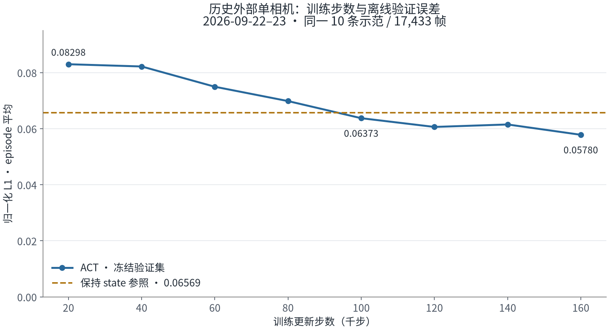
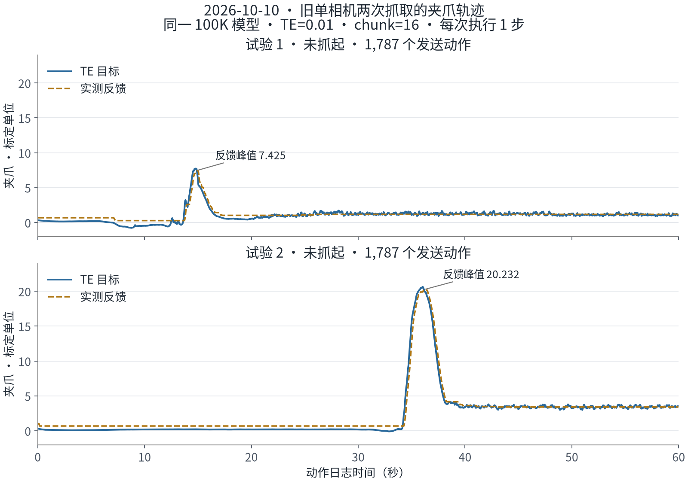

# ACT · SO-101 双摄像头抓取实验

**我们的双摄像头 ACT 已在真实 SO-101 上完成“抓起方块 → 放入黑袋 → 松爪撤离”。**

这是一项从数据采集、策略训练到真机部署的学习与复现实验。最终采用外部相机 `front` 与腕部相机 `wrist`，同时输入六维关节状态，由 LeRobot ACT 预测动作序列。今天的成功记录是本仓库的重点；过去的相似尝试合并为四条实验路线，保留问题、改进与证据。

## 先看成功记录

我们从今天的实录中整理了两个有明确现场成功标签、无人工纠正的案例：**中间位置**与**右侧位置**。两次均使用双摄像头 50 条示范训练的 **100K checkpoint**，部署开启 **Temporal Ensembling（TE=0.01）**，预测 100 步动作块、每次执行 1 步。现场记录的完成时间均约 15 秒，是观察者估计。

完整说明见 **[双摄像头成功记录](docs/dual-camera-success.md)**；精选动作数据与身份记录见 [成功案例索引](evidence/success-cases.json)。本页展示成功案例，不据此估计全部试验成功率。

## 这次怎么做到的

1. **输入改为两个互补视角。** 外部相机看工作区，腕部相机提供接近物体时的局部画面；同次示范配对保存两路图像、关节状态与动作标签。
2. **为双摄像头重新采集并训练。** 50 条示范、24,118 帧，640×480、名义 30 FPS；模型从新 ACT 参数与 ImageNet ResNet18 初始化训练 100,000 步。旧单相机模型不能直接通过接上第二只摄像头获得双视角能力。
3. **训练之外核对部署链路。** 保存 checkpoint 及自身处理器；新进程加载后完整动作块与首动作一致，双相机键与关节顺序一致。
4. **在真实机器人上完成任务。** 成功案例使用 TE 融合覆盖当前时刻的预测，并随新观测每次执行一步。成功体现为物体实际入袋与松爪撤离。

这是成功配置和过程的复盘。相机、数据、动作块长度和运行设置均经历变化，因此尚不能把成功归因于“只增加一只摄像头”或“只打开 TE”。

## 过去尝试与改进

| 合并后的实验路线 | 改了什么 | 留下的主要经验 |
|---|---|---|
| 外部单相机：数据与训练迭代 | 40 条基线、后 25 条重训、补 7 条现场示范、57 条原图；延长训练与调整执行方式 | 离线误差降低，但实机仍出现持位、抓偏、碰顶漏抓或空手放置 |
| 视觉标注：原图与叠框 | 在图像中加入物体、圆筒和夹爪候选框；试用版与修复版分开 | 修复版没有在已有配对指标上优于试用版；没有完成叠框真机成功率对照 |
| 纯腕部相机 | 53 条示范，43 条训练 / 10 条验证，ACT 120K；比较 TE 和动作门槛 | 跑满试验仍可能停滞；放宽门槛未解决已记录的问题 |
| 新机位单相机：方块入袋 | 50 条示范、100K，改机位与任务，开启 TE | 两次能向物体区域接近，第二次有明显张爪，但均未抓起 |

详细过程与工程修复见 [历史实验合并复盘](docs/experiment-history.md)。

### 历史图 1：训练更久，离线误差下降

同一冻结的 10 条验证示范、17,433 帧；纵轴为按 episode 平均的归一化 L1。保持状态参照也能获得不高的分数，说明整体误差需要结合关键阶段与实机结果解释。[图源数据](data/historical-validation.csv)

### 历史图 2：张爪了，仍不一定抓得起来

两次旧单相机开发试验各约 60 秒、1,787 个实际发送动作，均未抓起。第二次有明显实际张爪，失败不能一概解释为“不会张爪”。坐标为 SO-101 标定单位，不是角度或毫米。[图源数据](data/historical-gripper.csv)

## 为什么离线误差接近，实机效果却不同

**很多帧是相似、连续的移动或持位，而决定抓取成败的是短暂的对准、闭爪、抬起和释放窗口。平均误差按帧和关节累计，不会自动提高这些关键事件的权重。** 所以关键时刻的小变化，可能只让总分变化一点，却改变“抓住 / 抓空”的结果。

今天在相同的独立 5 条、2,337 帧上，双摄像头 100K 与追加加权微调 30K 的首动作 MAE 为 **2.6029 与 2.4579**，相差约 **5.57%**。复制当前 state 的参照更低，为 **1.9872**，但它不会主动完成抓取。这正说明平均误差不能直接当作任务能力。

上述数字比较的是**两个双摄像头版本**；它们不与历史单相机的归一化 L1 横向比较。今天精选的两次成功明确属于 **50 条 / 100K**，不能移记到后来的 70 条 / 30K 微调模型。详见 [离线误差与真实抓取](docs/offline-error-vs-task-success.md)。

## 仓库里有什么

- `docs/`：成功过程、历史改进、指标解释和复现边界。
- `configs/`：成功模型的 ACT 配置及整理后的训练 / 部署参数。
- `data/`：两张历史图的数值与两个成功案例的 0–20 秒精选动作片段。
- `evidence/`：原始记录相对路径、SHA-256、成功案例与指标摘要。
- `tools/`：从本地记录提取精选数据、重画历史图的工具。

原始视频、完整示范、模型权重、校准文件和认证信息保留本地。此仓库是轻量实验成果与证据包；完整训练及真机复现需要对应的本地资产。阅读 [复现与数据说明](docs/reproduction.md)。

## 基础项目

使用 [NVIDIA SO-101 Workshop](https://github.com/isaac-sim/Sim-to-Real-SO-101-Workshop) 的工程环境和 [Hugging Face LeRobot](https://github.com/huggingface/lerobot) 的 ACT 实现。本文记录本项目实验
